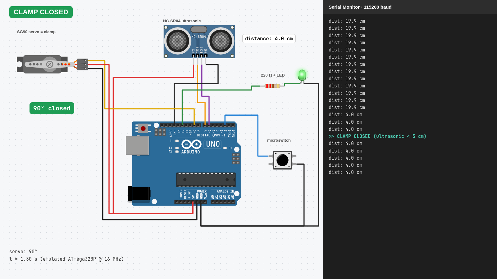
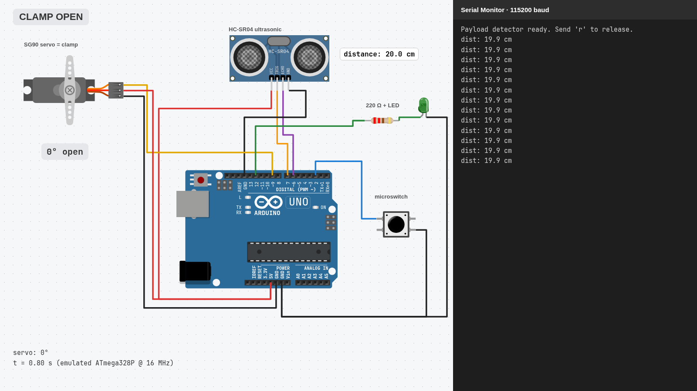

# Payload Detector: Arduino clamp trigger

My entry for **Track B (Electronics)** of the AUI Robotics Club Recruitment Challenge 2026.

The task: a robot has to carry a 30 mm wooden cube from Point A to Point B. This circuit is the part that senses the cube and grabs it. **When the cube comes within 5 cm, a servo turns 90° to close the clamp and an LED switches on.**



▶ **[Watch the 44-second simulation](video/Payload_Detector_Simulation.mp4)**: the real compiled firmware running on an emulated Arduino Uno.

## At a glance

| | |
|---|---|
| Board | Arduino Uno (ATmega328P, 5 V logic) |
| Language | Arduino C++: [`payload_detector/payload_detector.ino`](payload_detector/payload_detector.ino) |
| Sensors | HC-SR04 ultrasonic sensor **and** a microswitch inside the jaws |
| Outputs | SG90 micro servo (the clamp) and a green LED |
| Simulator | [Wokwi](https://wokwi.com): the circuit is in [`diagram.json`](payload_detector/diagram.json) |
| Size | 5.7 KB flash (17%), 262 B RAM (12%) |
| Tests | 11/11 logic tests pass on a PC with fake sensors, and 7/7 scenarios pass with the compiled `.hex` running in the avr8js AVR emulator |
| Real hardware | **Not built yet.** Everything here is simulated. The numbers come from datasheets (HC-SR04, SG90, ATmega328P) and Ohm's law, not from measurements. |

## What it does

| Situation | Result |
|---|---|
| Cube comes within 5 cm (3 readings in a row) | Clamp closes (servo 0° → 90°), LED on |
| Cube sits at 6 cm | Stays closed (5–7 cm hysteresis band) |
| Cube taken past 7 cm for 1 s | Clamp opens, LED off |
| Sonar sees nothing but the microswitch is pressed | Clamp closes anyway (backup sensor) |
| `r` typed in the Serial Monitor (at Point B) | Clamp releases and **stays open** until the cube is taken away, then re-arms |

| Idle, clamp open | Cube at 6 cm, stays closed | Microswitch, no echo |
|---|---|---|
|  |  |  |
| **Cube removed, clamp opens** | **`r` sent: released** | |
|  |  | |

## Wiring

| Part | Pin | Arduino | Why this pin |
|---|---|---|---|
| HC-SR04 | VCC / GND | 5V / GND | It needs 5 V and draws only about 15 mA |
| HC-SR04 | TRIG | D7 | Any digital output works |
| HC-SR04 | ECHO | D6 | Any digital input works (`pulseIn` isn't tied to a pin) |
| Servo | Signal | D9 | The Servo library uses Timer1, which disables PWM on D9/D10 anyway |
| Servo | V+ / GND | 5V / GND in the simulator; an **external supply** on real hardware (see [Power](#power)) | |
| Microswitch | one leg / other leg | D2 / GND | D2 is INT0, so it can become an interrupt later |
| LED | anode via 220 Ω / cathode | D12 / GND | Separate from the onboard LED on D13 |

**D0/D1 are left free:** they are the USB serial lines, and anything on them interferes with uploading and the Serial Monitor.

## Design choices

**Internal pull-up on the switch.** An open switch leaves the pin "floating", so it reads random noise. `INPUT_PULLUP` turns on the chip's internal resistor (about 20–50 kΩ) to 5 V. Released reads HIGH; pressed connects the pin to GND and reads LOW. No external resistor is needed.

**Debounce.** A mechanical switch's contacts bounce for a few milliseconds. A new switch state only counts after it has held steady for 20 ms.

**LED resistor.** (5 V − ~2 V LED drop) / 220 Ω ≈ **14 mA**. That's bright enough, under a typical LED's 20 mA rating, and well under an ATmega pin's 40 mA maximum.

**Two sensors.** The HC-SR04 has a blind zone below about 2 cm, so once the cube is in the jaws the sonar may lose it. The sonar sees the cube *coming*, and the switch *confirms contact*. Either one alone closes the clamp.

**Distance.** Sound travels 0.0343 cm/µs, and the echo measures the round trip, so distance in cm ≈ echo time in µs ÷ 58.

**Filtering:**
- **3 readings in a row** under 5 cm before closing, so one stray echo can't fire the clamp.
- **Hysteresis:** closes at 5 cm but counts the cube as gone only past 7 cm, so a cube sitting right at 5 cm doesn't make the clamp chatter.
- **1 s "gone" timer** before re-opening.
- **60 ms between pings**, as the HC-SR04 datasheet asks, so an old echo isn't read as a new one.
- **25 ms echo timeout**, so `pulseIn` doesn't block for its default 1 s when nothing is in range.

**State machine.** The firmware has three states: `OPEN`, `CLOSED` and `RELEASING`. `RELEASING` is what makes the `r` command work: without it the clamp would grab the cube again the moment it let go.

## Power

This is the part a simulator hides. An SG90 draws about 100–250 mA while moving and **around 700 mA when stalled**, and gripping a cube *is* a stall. On USB, the Uno's 5 V pin can supply only about 500 mA for the whole board. A servo powered from the Uno would cause voltage dips that reset the Arduino or corrupt the sonar readings.

On real hardware:
- Power the servo from a **separate 5–6 V supply rated ≥ 1 A**.
- **Connect that supply's GND to the Arduino's GND**, or the servo can't read the D9 signal.
- Put a **470 µF capacitor** across the servo supply to absorb current spikes.

Wokwi doesn't model current, which is why the simulation powers the servo from the Uno's 5 V pin.

## Run it in Wokwi

1. On [wokwi.com](https://wokwi.com), create a **new Arduino Uno project**.
2. Paste [`payload_detector.ino`](payload_detector/payload_detector.ino) into `sketch.ino`.
3. Replace the `diagram.json` tab with [this one](payload_detector/diagram.json).
4. Add a file `libraries.txt` containing `Servo`.
5. Press ▶, then:
   - Click the HC-SR04 and drag its distance below **5 cm**: the clamp closes and the LED lights.
   - Drag it back above **7 cm**: one second later it opens.
   - Press the **microswitch**: the clamp closes even when the sonar reads nothing.
   - Type **`r`** in the Serial Monitor to release the cube.

## Tests

### Logic tests (any PC with g++)

```bash
cd tests
g++ -std=c++17 -I. -x c++ logic_test.cpp -o logic_test && ./logic_test
```

This includes the real `.ino` and swaps `millis`, `pulseIn`, `digitalRead` and the Servo library for fakes. It checks 11 cases: far away, a stray echo, 4 cm, the hysteresis band, short and long removal, switch bounce, microswitch with no echo, the `r` release, and re-arming. It tests the logic only, not the wiring or real-world timing.

### Emulator (the real compiled firmware)

[`emulator/`](emulator) runs the compiled `.hex` on [avr8js](https://github.com/wokwi/avr8js), the open-source AVR emulator Wokwi is built on. The sensors are faked: a TRIG pulse gets an ECHO pulse `distance × 58 µs` long, the servo angle is read from the pulse width on D9, and the switch pulls D2 LOW. It also produces the screenshots and the video.

Needs Node.js and [`arduino-cli`](https://arduino.github.io/arduino-cli/):

```bash
cd emulator && npm install
arduino-cli compile --fqbn arduino:avr:uno --output-dir build ../payload_detector
node verify.mjs                                                          # 7 scenarios, PASS/FAIL
npx esbuild page.mjs --bundle --loader:.hex=text --outfile=bundle.js
node shoot.mjs ../screenshots                                            # screenshots (needs Chromium at /usr/bin/chromium)
node record.mjs ../video/Payload_Detector_Simulation.mp4                 # video (also needs ffmpeg)
```

## Project layout

```
payload_detector/   the Arduino sketch, Wokwi wiring (diagram.json), libraries.txt
tests/              host-side logic tests + a fake Servo.h
emulator/           avr8js harness: verify, screenshots, video
screenshots/        6 PNGs from the emulator
video/              44 s simulation video (1600×900, real time)
```

## With more time

- Build it on real hardware with the external servo supply, and measure the actual stall current.
- Stop at a smaller angle once the cube is gripped, so the servo isn't stalled the whole time.
- Move the switch to an interrupt (`attachInterrupt` on D2) for an instant response.
- An ESP32 version that reports "payload secured" to the path planner (Track A) over Wi-Fi. Its ECHO pin would need a 5 V → 3.3 V divider.
